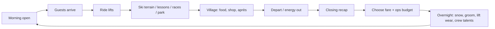

# Ice Coast Revival — design analysis (reference for **Last Chair**)

> **Purpose:** Capture how ICR works so **Story Mode** can match **Build the Mountain (Simple) loop feel** (not a literal feature clone). **v1 gates:** [FEEL_SCORECARD.md](./FEEL_SCORECARD.md). **110%** waits until P0 is fun on mobile — [IMPROVEMENTS_PASS.md](./IMPROVEMENTS_PASS.md).  
> **Sources:** Official manual/talents (v1.4.3 core / web 1.4.6), marketing pages, Steam listing, builder notes.  
> **Our product:** *Last Chair* — working title aligned with `cholula-cloud/last-chair` (“Slopes Tycoon”).

---

## 1. Elevator pitch (what we are cloning)

ICR is a **single-player browser ski-resort tycoon** set in **New England**. You buy/reopen a **foreclosed independent mountain**, then over a **28-day winter season** (with real-time day simulation):

- Place **lifts** and **terrain** (runs, glades, park, race, Nordic).
- Run **snowmaking, grooming, and lift operations** overnight.
- Grow a **base village** (lodge tier, F&B, rentals, school, après).
- Manage **fares, operating budgets, debt, and full financial statements**.
- Serve **individually simulated guests** whose mood drives satisfaction, reputation, and career XP.
- Progress a **multi-mountain career** based on **real lost ski areas**, with **70 talents**, **7 talent sets**, and **6 founders**.

Platform: Web-first (also native stores). **3D miniature-mountain presentation** with deep management on pause or live.

---

## 2. Core player loop (one mountain day)

**Design insight:** The loop is not “build bigger forever in one session.” It is **diagnose bottlenecks → change one lever → read tomorrow’s recap**. Named trails are optional; connectivity and snow coverage matter more than signage.

### 2.1 Simple vs Complex

| Mode | Build | Daily ops | Talents |
|------|--------|-----------|---------|
| **Build the Mountain (Simple)** | Player | Player sets fare + **Snow & service** tier; crew runs细节 | Fixed **crew order** (70-step priority list) |
| **Build and Run (Complex)** | Player | Player sets operations + finance views | Player picks tree; **reset credits** at career milestones |

Both share **one career**, buildings, level, and paid venue conversions.

### 2.2 Season & meta

- **28 in-game days** per winter; **winter review** closes books (no separate off-season construction phase).
- **Career** spans multiple mountains; **caretakers** simulate hills you left behind.
- **Talents** (70 points, 3 trees × 3 branches) persist; **effects require facilities** on the current hill.
- **7 themed sets** (6 talents each): e.g. Family Hill, Race Academy, Storm Mountain — bonus from next morning when complete.
- **Quick Play / Sandbox**, **Daily Challenge** (web) / rotating micro-games (newer iOS), **Hill Cup** weekly snapshot voting.
- **Day bank** (free players): capped playtime refilled at local midnight (monetization / Region / Pro uncap).

---

## 3. Simulation pillars (what makes it “deep”)

### 3.1 Guest model

Each guest has a **day script**: Arrive → Ride → Ski → Refuel → Return (loopable).

**Satisfaction** aggregates: arrival mood, ticket value, crowding, queues, snow quality/depth, falls, lessons, venues, activities. **Reputation** is longer-horizon. **Village Character** (variety, decoration, grades, lodge tier) affects arrival mood separately.

**Follow-a-guest** is the primary debug tool in Simple; Complex adds **Guests / Report** breakdowns.

### 3.2 Terrain & lifts

- Lifts need **reachable load + continuous skiable descent** from unload.
- **Draw runs**: trace downhill, difficulty from geometry (mislabeling greens on steep pitch punishes you).
- **Glades** = retained trees; different risk/skill from cleared runs.
- Lift types: surface → chair/quad → gondola → specialized (telemix, funicular); **weather** closes or throttles types (wind holds; talents like Wind Watch).

### 3.3 Snow system

Three axes: **depth** (keeps routes open), **quality** (corduroy, fresh, ice), **coverage**.

- Natural snow + settling + **thaw** (especially low elevations).
- **Guns**: reach from base uphill; intensity vs coverage tradeoff.
- **Grooming capacity** per night — marking everything priority does not grow the fleet.
- Talents: Trail Guns, Night Shift, Half and Half, Across the Mountain (ultimate), etc.

### 3.4 Village & economy

- **Lodge tiers**: Warming Hut → Base → Mountain → Grand ($125k / $225k / $400k steps) — arrival mood, seats, revenue %, demand caps.
- Venues: café, restaurant, chalet, shop, school, rink, bar, lounge, inn, arena, trampoline barn, etc.
- **Concept menus** (Burger Shack, Farm to Table, …) + **grades** (Standard → Well-kept → Beloved) for eligible venues.
- Inspector shows **direct contribution** (revenue − venue staff); shared hill costs separate.
- **Operating net ≠ cash flow** — construction drains cash on profitable days.

### 3.5 Weather & career geography

- **Thaw**, **storms**, **wind holds** reshape daily plans.
- Career moves toward **higher, colder** hills; warming climate makes low southern hills less reliable (narrative + mechanic).

### 3.6 Narrative frame (underused but strong hooks)

- **Lost New England areas** (historical).
- **Six founders** with different constraints (e.g. Alex Francis: repairs lifts overnight, no loans; Preservationist: clearing is costly).
- **Apex Summit Collective** megapass antagonist (buyouts, poaching) — Steam copy emphasizes this more than early web marketing.
- Builder intent: **business literacy** — income statement, balance sheet, cash flow, valuation.

---

## 4. Progression: talent trees (condensed)

**70 talents**, 1 point each, shared pool. Three trees:

1. **Mountain** — Lifts, Snow, Patrol (+ ultimates: Summit-to-Summit gondola, Across the Mountain guns, Rescue Helicopter).
2. **Village** — Food, Nights, Shops (+ Worth the Drive, Headliners, House Brand).
3. **People** — Race, Park, Backcountry (+ Home of a Champion, The Open, Down the Wall).

**Crew order (Simple)** starts: Two to a Bar → Rope Tow → House Band → … (full list on talents page). Crew **buys talents even if facilities missing** — effects wait until built.

**Resets (Complex):** credits at levels 10–60 (step 10) + first Simple→Complex switch; buildings and career level retained.

---

## 5. What players love (and where friction is)

From manual emphasis + community tone (Reddit thread timed out; Steam reviews pattern):

| Strength | Opportunity for Last Chair |
|----------|----------------------------|
| Cozy **3D diorama** + serious spreadsheets | Push **visual storytelling** without hiding the books |
| “One queue, one guest” teaching | **Guided scenarios** + optional AI ops advisor |
| Real **lost areas** fantasy | Expand with **documented oral histories** (ethical original fiction) |
| Talents as long-term identity | **Synergy UI** — show dormant talents until facility exists |
| Financial depth | **Tutorialized CFO mode** for students / hospitality programs |
| Pause-anytime planning | **Time controls** (0.5×–4×) with mobile-friendly touch targets |

**Friction to fix in our UI:**

- Simple vs Complex feature split across versions (iOS vs web).
- Dense inspector tabs on phone; fare/ops buried in recap.
- Talent prerequisites + facility gates are easy to misunderstand.

---

## 6. ICR full surface (reference over time)

**Not** Last Chair v1 acceptance — that is [FEEL_SCORECARD.md](./FEEL_SCORECARD.md). Use this list as a **long-horizon mechanics bibliography** when extending toward ICR depth:

- [ ] Real-time day + overnight resolution
- [ ] Lift build preview (terminals, line, quote)
- [ ] Trail draw + difficulty + sign posting
- [ ] Snow depth/quality/coverage overlays
- [ ] Grooming + snowmaking queues
- [ ] Weather + lift constraints
- [ ] Individual guest AI + follow camera
- [ ] Village venues + lodge upgrades + menu concepts
- [ ] Ticket fare + operating budget (Simple crew / Complex manual)
- [ ] P&L, balance sheet, cash flow screens
- [ ] 28-day season + winter review
- [ ] Career map + second mountain + caretaker earnings
- [ ] 70 talents + sets + resets
- [ ] 6 founders + difficulty modifiers
- [ ] Cloud save + cross-device (account)
- [ ] Hill Cup / daily challenge (phase 2 OK)
- [ ] Desktop + mobile WebGL

---

## 7. Legal / ethics note

We **do not** copy assets, code, audio, or trademarked names. We **do** replicate **genre mechanics** (tycoon + ski ops) and **public game-design documentation**, with original art, mountains, story, and UI.

---

## 8. Technical inference (ICR, not confirmed open source)

- Browser + native: likely **WebGL 3D** (Steam: DirectX 11 class GPU; ~1 GB storage).
- Individually simulated skiers imply **entity component** or agent loop on terrain nav mesh / heightfield.
- Heavy UI + pause suggests **simulation thread** or fixed tick with UI on React/Vue/similar for web.

**Last Chair stack recommendation:** see `IMPLEMENTATION_ROADMAP.md`.
