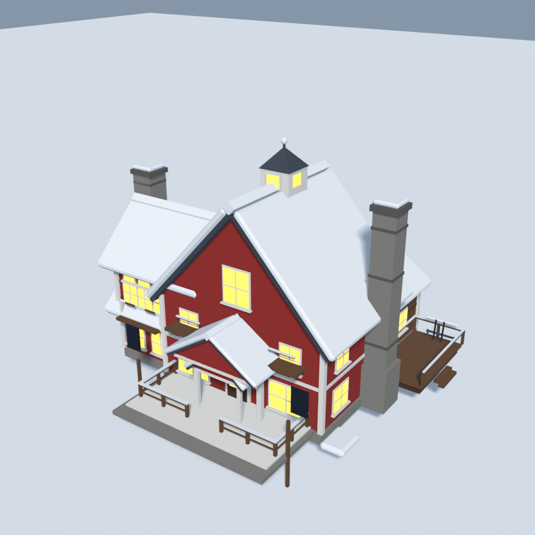
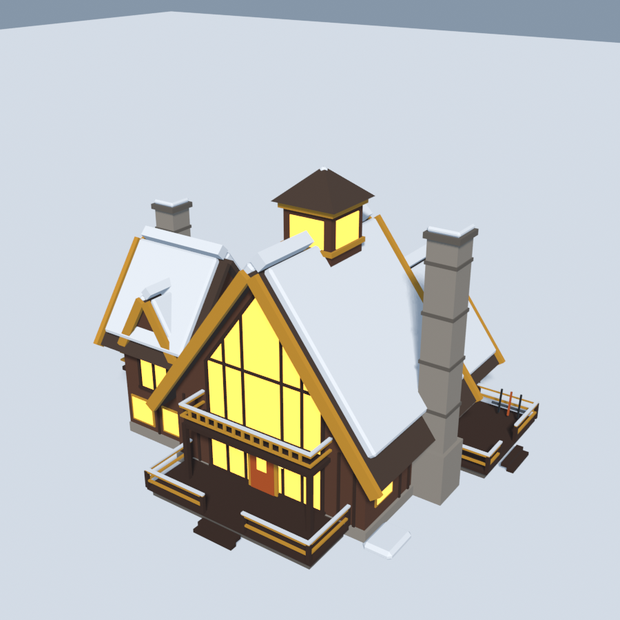
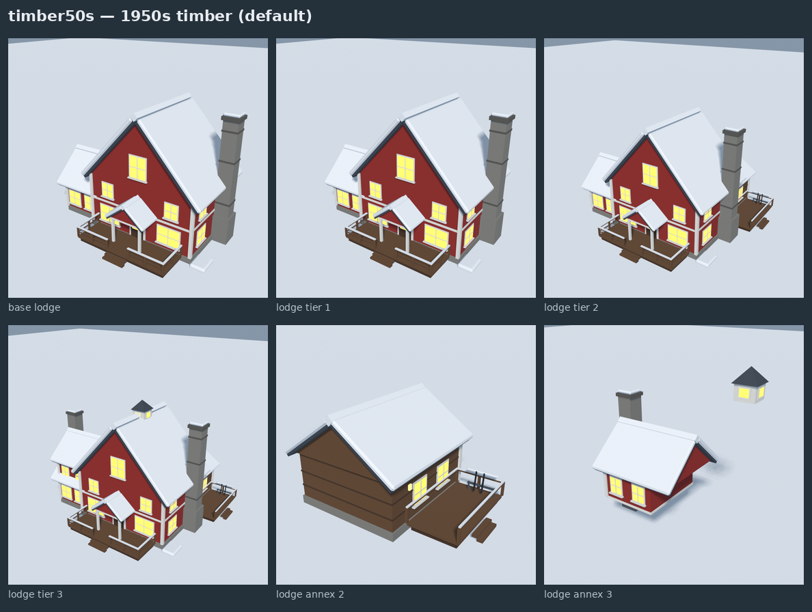

# Lodge style reference (Blender)

Two cosmetic families ship for the Dutch Hill lodge and base venues:

| Style id | Kit name | Look |
|----------|----------|------|
| `1950s-timber` | `timber50s` | Barn-red walls, white trim, slate roof, timber deck |
| `chalet70s` | S2 pack | Dark cedar, steep gable glazing, ochre trim |

Tier upgrades stack annex GLBs (`base-lodge` + `lodge-annex-2/3`, or the `*-chalet70s` counterparts). **Tier 3** adds a grand dining wing upper storey, stone entry terrace, widened galleries, lanterns/string lights, ridge cupola, and banner poles—on both `lodge-annex-3` and `lodge-annex-3-chalet70s`. Full-shell `lodge-tier-3*` meshes match that look for asset review.

Blender EEVEE review renders (same pipeline as `tools/blender/lib.py` `render_asset`):


**Tier 3 grand lodge** (post upscale pass):








Regenerate headless renders (requires Blender 4+):

```bash
blender --background --factory-startup --python tools/blender/render_lodge_styles.py
```

Output defaults to `docs/reference/lodge-style-renders/`.